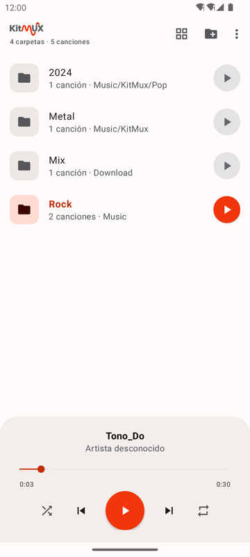
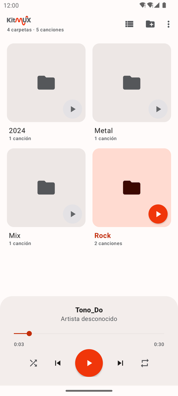
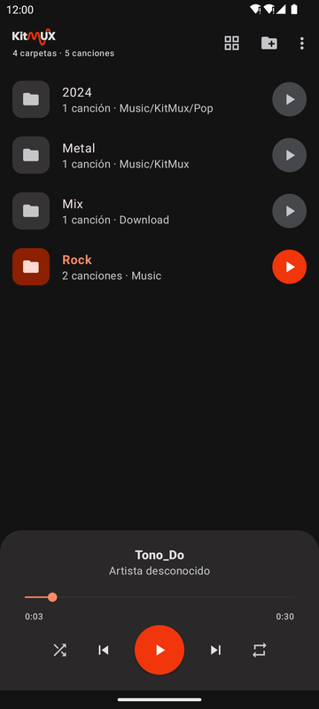

<p align="center">
  
</p>

<p align="center">
  Reproductor de música local para Android, organizado por carpetas,<br>
  con sincronización de música desde el PC por WiFi.
</p>

<p align="center">
  
  
  
  
</p>

## Características

- **Biblioteca por carpetas**: escanea la música del dispositivo y la agrupa por carpetas, en vista de **lista** o **cuadrícula**. También puedes añadir cualquier carpeta concreta con el selector del sistema.
- **Reproducir una carpeta entera** con su botón ▶. Si es la que suena, el mismo botón la pausa.
- **Reproducción en segundo plano**, con notificación y controles en la pantalla de bloqueo y en auriculares Bluetooth. Pausa sola al desconectar los auriculares.
- **Aleatorio y repetir** (todas o una).
- **Recibir desde PC**: un script de Python vigila una carpeta del ordenador y refleja sus cambios en el teléfono por la red WiFi local, sin cables.
- **Modo claro y oscuro**, con un sistema de diseño basado en los colores del logo.

## Requisitos

- Android 8.0 (API 26) o superior.
- Para compilar: Android Studio reciente o JDK 17+ (Gradle descarga el JDK 25 del toolchain automáticamente).

## Compilar e instalar

```bash
./gradlew assembleDebug        # genera app/build/outputs/apk/debug/app-debug.apk
./gradlew installDebug         # instala en el dispositivo o emulador conectado
./gradlew test                 # tests unitarios
```

Al abrirla, la app pide permiso para leer la música. Sin ese permiso puedes seguir añadiendo carpetas a mano con **Añadir carpeta**.

## Sincronizar música desde el PC

La app incluye un receptor y [`tools/kitmux_sync`](tools/kitmux_sync) es el script para el ordenador. Lo que copias, renombras o borras en una carpeta del PC se refleja en **Música/KitMux** del teléfono.

1. **En el teléfono**: menú ⋮ → **Recibir desde PC**. El teléfono tiene que estar en la misma WiFi que el ordenador.
2. **En el ordenador** (macOS, Linux o Windows con Python 3.10+):

   ```bash
   cd tools/kitmux_sync
   python3 -m venv .venv
   .venv/bin/pip install -r requirements.txt
   .venv/bin/python kitmux_sync.py pair                    # una sola vez: escribe el código que muestra la app
   .venv/bin/python kitmux_sync.py sync ~/Music/KitMux     # vigila la carpeta y sincroniza
   ```

En Windows usa `.venv\Scripts\python` en lugar de `.venv/bin/python`.

El script encuentra el teléfono por mDNS y solo envía las diferencias, también tras una desconexión. Detecta los renombrados para no reenviar archivos, y solo copia audio. Opciones, funcionamiento y seguridad en su [README](tools/kitmux_sync/README.md).

## Estructura

| Ruta | Contenido |
|---|---|
| `app/src/main/java/.../data` | Escaneo de la biblioteca (MediaStore y carpetas elegidas por el usuario) |
| `app/src/main/java/.../playback` | Servicio de reproducción (Media3 / ExoPlayer) |
| `app/src/main/java/.../sync` | Receptor «Recibir desde PC»: servidor HTTP local, mDNS y emparejado |
| `app/src/main/java/.../ui` | Pantallas de carpetas y canciones, reproductor |
| `tools/kitmux_sync` | Script de sincronización para el PC, con sus tests |
| `docs/design-system.md` | Sistema de diseño: colores, espaciado, tipografía y componentes |

## Tests

```bash
./gradlew test                                             # app (JVM)
cd tools/kitmux_sync && .venv/bin/python -m unittest       # script del PC (incluye un teléfono simulado)
```

## Licencia

KitMux se distribuye bajo la [PolyForm Noncommercial License 1.0.0](LICENSE.md):

- **Gratis para uso no comercial** (personal, educativo, investigación, sin ánimo de lucro), siempre manteniendo el aviso de autoría.
- **El uso comercial requiere una licencia de pago.** Consulta [COMMERCIAL.md](COMMERCIAL.md).

Copyright (c) 2026 Alejandro Lozano Medina.
